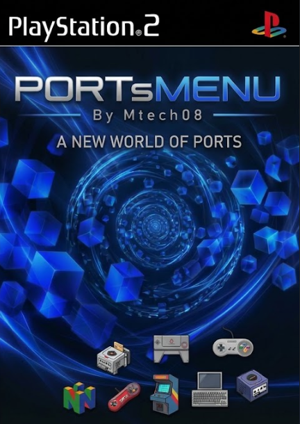

# PORTsMENU

<p align="center">
  
</p>

**Launcher de homebrew para PlayStation 2** — un menú tipo "multijuego" hecho desde cero (C puro, sin gsKit ni libgraph) que escanea automáticamente tus juegos, muestra covers con animaciones y los lanza. Todo empaquetado en **una sola ISO autocontenida**, al estilo de los ports clásicos de la escena.

```
PORTsMENU — By Mtech08
Open source · PS2 (EE/IOP) · ISO9660 propio · C99
```

---

## Características

- **Auto-escaneo de juegos**: copia un ELF a `ELFS/` y su cover a `ART/COV/` con el mismo nombre — aparece en el menú sin tocar nada más.
- **Carrusel 3D estilo Aurora**: cover central grande con marco pulsante y flotado, vecinos escalonados a los lados con reflejo en el piso, transiciones deslizantes suaves.
- **Covers y fondos**: soporta `JPG / PNG / BMP / TGA / GIF` (vía stb_image) con cache LRU en VRAM, downscale por tipo de asset y gate anti-overflow del heap.
- **Fondo global personalizable** (640×448 nativo) + **pantalla de boot** personalizable con precarga progresiva de covers durante el splash.
- **Renderer GS manual**: primitivas SPRITE / TRIANGLESTRIP / TRIANGLEFAN, clipping por software contra pantalla, alfa GS correcta (0x80 = 1.0), texturas RGBA32 subidas por bandas DMA (sin romper el límite de 16 bits de QWC).
- **Launcher real**: `LoadExecPS2` con `argv[0]` apuntando al juego — los ports derivan la carpeta de sus datos de ahí (comportamiento estándar de la escena).
- **Generador de ISO9660 propio**: path tables válidas (root 0x00, parents secuenciales), nombres 8.3, layout convencional — probado en PCSX2 y listo para grabar a DVD en PS2 real.
- **Menú de configuración (SELECT / TRIÁNGULO)**: idiomas en vivo (Español / English / Português), ordenación alfabética A-Z / Z-A y **reordenación manual** de juegos (L2/R2 directamente en el carrusel).
- **Persistencia**: guarda juego seleccionado, idioma, modo de orden y lista personalizada (`portmenu.cfg` en memory card / USB / host).
- **Multi-medio**: detecta el medio de arranque (`cdrom0:` en ISO/DVD, `host:` en PCSX2, `mass:`, `mc0:`, `hdd0:`), con detección de HLE falso del emulador y fallback automático.

---

## Controles

| Botón | Acción |
|---|---|
| ← / → | Navegar en el carrusel |
| L1 / R1 | Saltar 5 juegos |
| X (Cross) | Lanzar el juego |
| L2 / R2 | Mover el juego (reordenar biblioteca) |
| SELECT o TRIÁNGULO | Menú de configuración (idioma, orden) |
| START | Ir al primer juego |

```
PORTMENU.iso                    <- TODO va dentro (menú + juegos + arte)
├── SYSTEM.CNF                  <- BOOT2 = cdrom0:\PORTMENU.ELF;1
├── PORTMENU.ELF                <- el menú (boot principal)
├── GAMES.CFG                   <- (opcional, puede estar vacío)
├── ART/
│   ├── BG/
│   │   ├── BASE.JPG            <- fondo del menú (640x448 recomendado)
│   │   └── BOOT.JPG            <- splash de arranque (opcional)
│   ├── COV/
│   │   ├── MIJUEGO.JPG         <- covers (mismo nombre que el ELF)
│   │   └── ...
│   └── LOGO/
│       └── MIJUEGO.JPG         <- logos (opcional)
└── ELFS/
    ├── MIJUEGO.ELF             <- juego suelto, o:
    └── MIJUEGO/
        ├── MIJUEGO.ELF         <- juego con su carpeta de datos
        └── (assets del port)   <- main.pak, assets.pak, etc.
```

---

## Añadir juegos (cero configuración)

1. Copia el ELF del juego a `ELFS/` (suelto o en su propia carpeta).
2. Copia el cover a `ART/COV/` **con el mismo nombre** que el ELF.
3. Listo. El menú escanea al arrancar.

```
ELFS/OPTICRAFT/OPTICRAFT.elf     +   ART/COV/OPTICRAFT.JPG
ELFS/PVZPS2/PVZ_PS2.ELF          +   ART/COV/PVZ_PS2.JPG
```

- Extensiones de imagen aceptadas: `.JPG .jpg .JPEG .jpeg .PNG .png .BMP .bmp` — cualquier combinación de mayúsculas/minúsculas.
- El título sale del nombre del archivo (los `_` se convierten en espacios).
- El matching de covers tolera truncado 8.3 (necesario dentro de la ISO): `OPTICRAFT.elf` ↔ `OPTICRAF.JPG` hacen match.

> **Nota**: los ports necesitan sus archivos de datos (`main.pak`, `assets.pak`, ROMs, etc.) junto al ELF — el menú les pasa la ruta como `argv[0]` para que los encuentren solos.

---

## `games.cfg` (opcional)

El archivo `games.cfg` **no es necesario**. Solo úsalo para:

- **Personalizar el título** de un juego ya escaneado.
- **Añadir ELFs fuera de `ELFS/`** (memory card, HDD, otro dispositivo).

```ini
# titulo|ruta_elf|cover|logo||genero|anio|descripcion
OptiCraft|ELFS/OPTICRAFT/OPTICRAFT.elf|COV/OPTICRAFT.JPG||Sandbox|2024|Minecraft para PS2
uLaunchELF|mc0:/BOOT/BOOT.ELF|COV/ULAUNCH.JPG||||Utilidad|2000|Explorador de archivos
```

Las rutas relativas se resuelven contra el medio donde esté el `games.cfg`.

---

## Compilar

### Requisitos (Windows)

- [PS2DEV](https://github.com/ps2dev/ps2dev) toolchain (GCC MIPS R5900) — probado con GCC 15.2.0
- [CMake](https://cmake.org/) ≥ 3.20
- [Ninja](https://ninja-build.org/)
- GCC nativo (incluido con MSYS2, para el generador de ISO)

### Build

1. Edita las rutas en `build.bat` y `ps2_toolchain.cmake` (apuntan a tu `ps2dev`).
2. Corre:

```cmd
build.bat
```

Output:

```
build\PORTMENU.elf      <- el menú
build\PORTMENU.iso      <- ISO autocontenida (menú + juegos + arte)
```

El `build.bat` compila el ELF, arma el staging (`SYSTEM.CNF`, `GAMES.CFG`, junctions a `ART/` y `ELFS/`) y genera la ISO con `tools/mkiso.exe`.

---

## Instalar

### PCSX2

1. `Config → CDVD → ISO Selector → Browse` → elige `PORTMENU.iso`.
2. Arranca. El menú lista los juegos que están dentro de la ISO.

### PS2 real

> **Importante**: la PS2 real **no bootea CD-R/DVD-R grabados directamente** (verifica la licencia del disco original). La ISO sirve solo para PCSX2 o consolas con modchip. En hardware real usa una de estas vías:

- **FMCB + USB (recomendado)**: copia `PORTMENU.ELF` + `ELFS/` + `ART/` (+ `N64/` si hay ROMs) a la raíz del USB y lanza el ELF desde FreeMcBoot. El scan detecta `mass:` automáticamente.
- **OPL**: mismo esquema desde USB/HDD.
- **Memory card**: copia todo a `mc0:/` y lanza con uLaunchELF.
- **Modchip**: con chip instalado el CD/DVD grabado sí bootea como disco y el menú corre 100% desde `cdrom0:`.

---

## Detalles técnicos

### Renderer (gs_renderer.c)
- GS configurado a mano: `SetGsCrt(NTSC interlaced FIELD)`, circuito de video 1, framebuffer PSM32 640×448, packets GIF PACKED+AD por DMA.
- Texturas subidas **por bandas** (cada transferencia DMA ≤ 16000 qwords) para respetar el límite de 16 bits del campo QWC — permite fondos 640×448 completos.
- Rects redondeados con `TRIANGLEFAN` (4 arcos de esquina, polígono cerrado).
- Alfa en escala GS (`0x80 = 1.0`), blending automático solo en primitivos semitransparentes.

### VRAM y assets (asset_manager.c)
- Allocator VRAM con free-list first-fit (4 MB, texturas desde `0x120000`).
- Cache LRU (24 texturas) con **pin** para el fondo permanente y flag `failed` para no reintentar assets inexistentes cada frame.
- Downscale proporcional **por tipo de asset** (fondo 640×448, covers 320×480, logos 320×96) con gate previo por `stbi_info` — protege el heap del EE de decodificaciones gigantes.

### ISO (tools/mkiso.c)
- Generador ISO9660 nivel 1 escrito desde cero (~450 líneas de C): PVD + terminator + path tables L/M + directory records + extents.
- Path table conforme a la spec: root = identificador de 1 byte `0x00`, parent `1`; números de directorio secuenciales (los ports de la escena y el cdvdman del IOP lo exigen).
- Sanitiza nombres a 8.3 automáticamente (con resolución de colisiones) — el matching de covers del menú compensa el truncado.

### Escaneo (ui_menu.c)
- `opendir`/`readdir` sobre el medio detectado; soporta ELFs sueltos y anidados un nivel (`JUEGO/JUEGO.ELF`).
- Matching de covers: exacto → prefijo común ≥ 3 caracteres (case-insensitive).
- `games.cfg` como capa de override/dedup con matching difuso por nombre base.

---

## Solución de problemas

| Síntoma | Causa probable |
|---|---|
| "ELF no encontrado" (mensaje rojo) | La ruta del ELF no existe en ese dispositivo — revisa el nombre |
| Cover no aparece | El cover no se llama igual que el ELF (o no está en `ART/COV/`) |
| El juego abre sin sus datos | El port busca sus assets junto al ELF — revisa que la carpeta esté completa |
| Pantalla negra al boot | Falta `ART/BG/BOOT.*` (usa el fallback de texto) — no es error |
| Spam `dopen mass:/` dentro de un juego | Es el **port** buscando USB para saves — normal sin USB |

El menú escribe un log en `PORTMENU.log` junto al ejecutable (`host:PORTMENU.log` en PCSX2) con el escaneo, VRAM y lanzamientos.

---

## Estructura del repo

```
├── build.bat                  # build + ISO en un paso
├── make_iso.ps1               # staging + llamada a mkiso
├── ps2_toolchain.cmake        # toolchain MIPS R5900
├── CMakeLists.txt
├── games.cfg                  # opcional (vacío por defecto)
├── src/platform/ps2/
│   ├── main.c                 # init, splash, loop principal, pad
│   ├── gs_renderer.c/h        # renderer GS manual (DMA/GIF)
│   ├── asset_manager.c/h      # cache LRU + stb_image + VRAM
│   ├── ui_menu.c/h            # escaneo, grid, input, lanzamiento
│   ├── font8x8.c/h            # fuente bitmap (public domain)
│   └── stb_impl.c             # implementación de stb_image
├── tools/
│   ├── mkiso.c                # generador ISO9660 PS2
│   └── mkiso.exe
└── build/                     # output (elf, iso, ART/, iso_root/)
```

---

## Créditos

- **stb_image** — Ryan Gordon / nothings (public domain): decodificación JPG/PNG/BMP/TGA/GIF.
- **font8x8** — Marcel Sondaar / Daniel Hepper (public domain): fuente bitmap 8×8.
- **mkiso** — escrito desde cero para este proyecto (public domain), siguiendo la estructura de las ISOs homebrew de la escena PS2.
- Inspirado en los launchers y ports de la escena: uLaunchELF, OPL, FMCB y los ports N64→PS2.

## Licencia

MIT — usa, modifica y comparte. El hardware y las BIOS son de sus dueños; este proyecto no incluye ninguno.
